# Paralela 45 – Cărți digitale

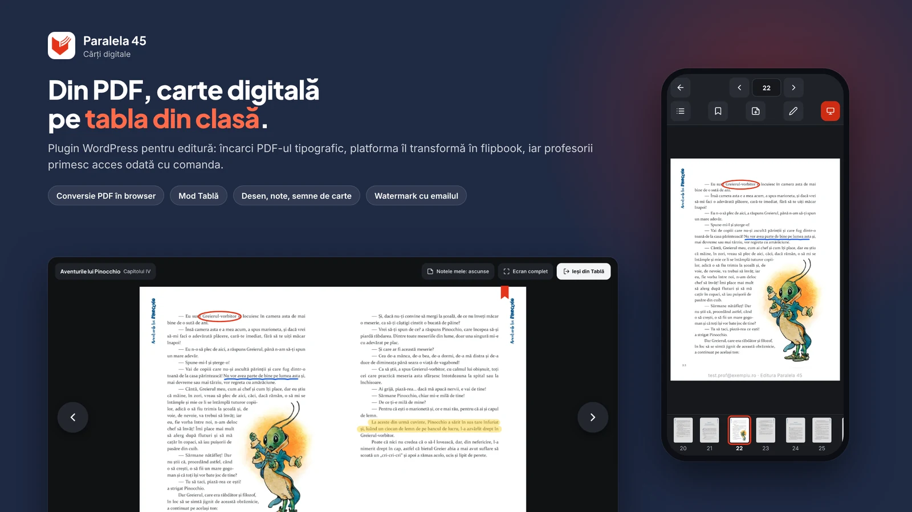


Plugin WordPress pentru **Editura Paralela 45**. Profesorul care cumpără cartea tipărită primește și varianta ei digitală, pe care o deschide **pe tabla interactivă din clasă**.

Editura încarcă PDF-ul de tipar din panoul WordPress. Platforma îl transformă singură într-o carte care se răsfoiește, îi găsește cuprinsul și dă acces profesorilor odată cu comanda.

- **Pentru profesor:** cărțile primite, un cititor de tip flipbook, desen peste pagini, note, semne de carte și Mod Tablă.
- **Pentru editură:** carte nouă direct din PDF, acces pe bază de comandă, emailuri automate și import CSV.
- **Fără servicii externe:** totul rulează pe hostingul editurii, iar conversia se face în browserul celui care încarcă PDF-ul.

---

## Cuprins

- [Cum arată](#cum-arată)
- [Ce poate face](#ce-poate-face)
- [Cum funcționează](#cum-funcționează)
- [Instalare](#instalare)
- [Structura codului](#structura-codului)
- [Detalii tehnice](#detalii-tehnice)
- [Dezvoltare](#dezvoltare)
- [Licență](#licență)

---

## Cum arată

### Pentru profesori

| Intrarea în cont | Biblioteca |
|---|---|
| 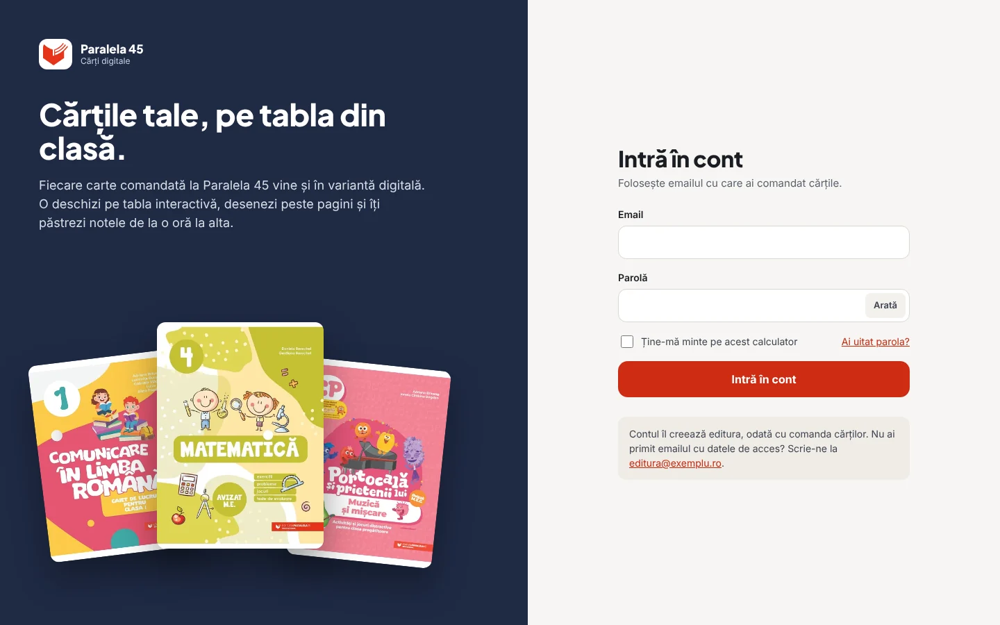 | 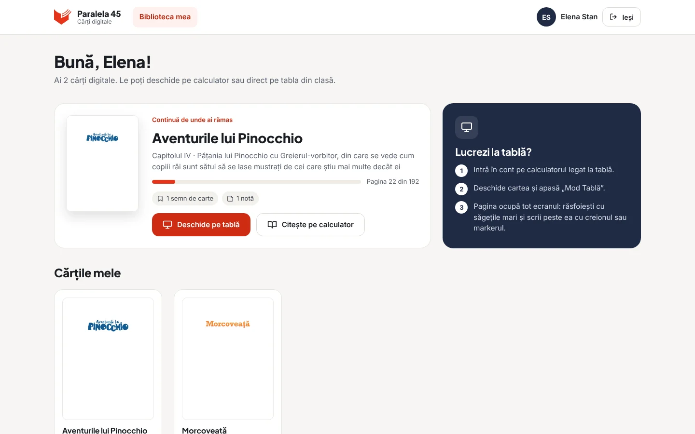 |
| Contul îl creează editura. Profesorul primește un email cu link pentru parolă. | „Continuă de unde ai rămas”, cărțile primite, progresul, semnele de carte și notele. |

**Cititorul, cu desen peste pagini.** Profesorul poate folosi creionul, markerul și radiera în cinci culori. Desenele se păstrează în cont.

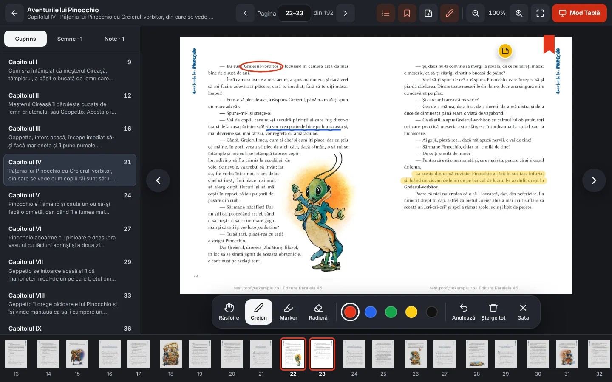

**Mod Tablă.** Pagina ocupă tot ecranul, cu săgeți mari pentru răsfoit și o bară de unelte jos, la îndemâna profesorului de lângă tablă. Notele rămân ascunse până le afișează el.

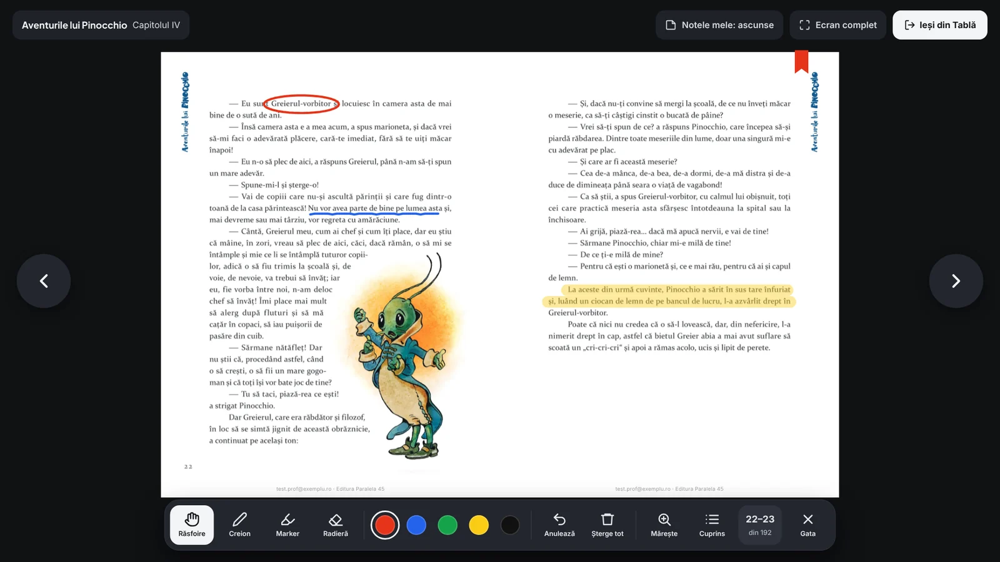

| Note și semne de carte | Pe telefon |
|---|---|
| 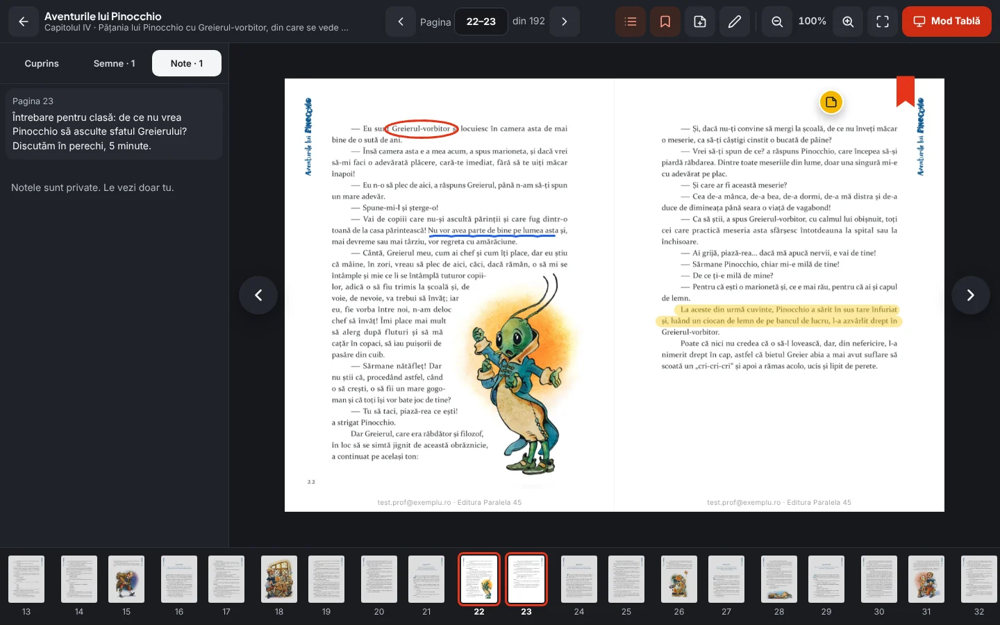 | 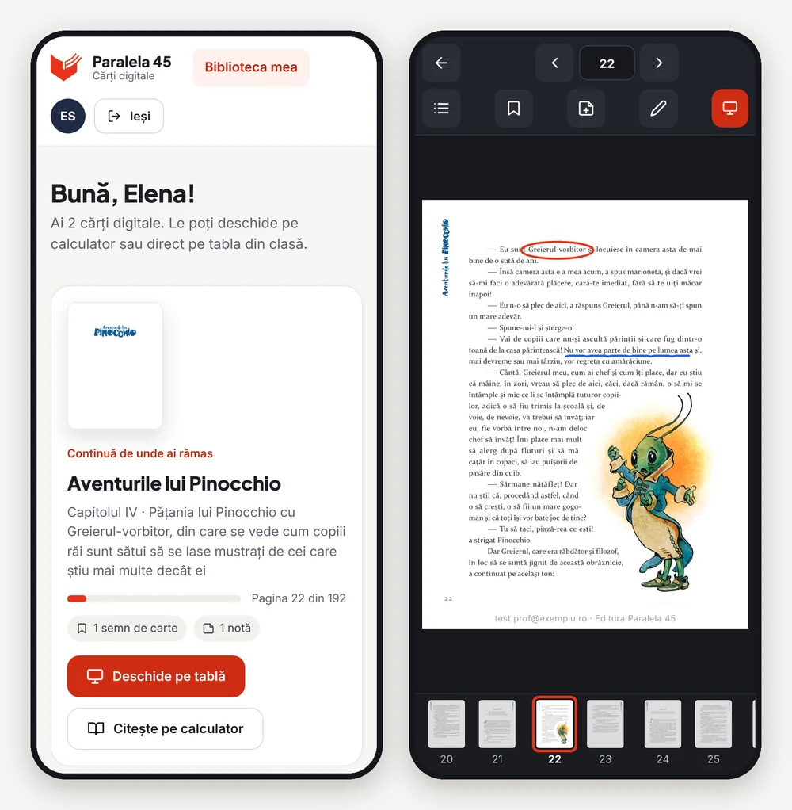 |
| Notele sunt private și se văd doar în contul profesorului. | Pe ecran îngust, cititorul arată câte o pagină. |

### Pentru editură (panoul WordPress)

| Carte nouă din PDF | Cuprinsul găsit automat |
|---|---|
| 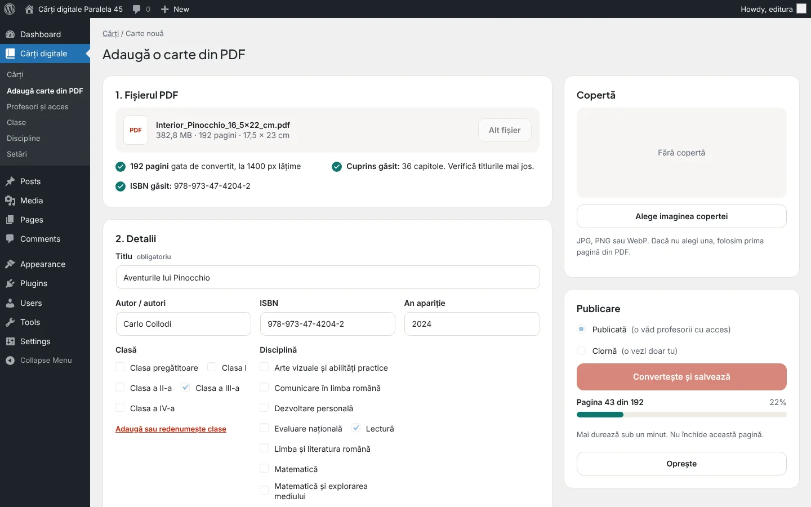 | 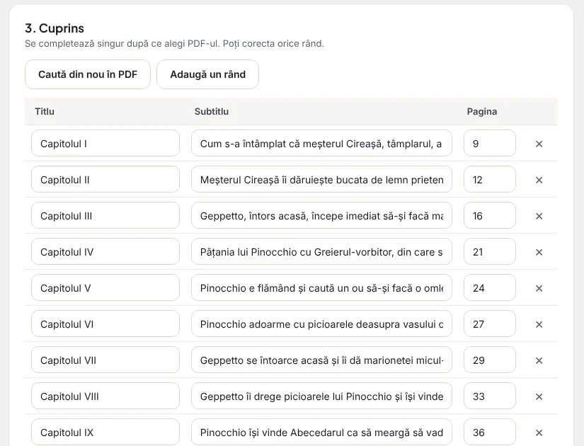 |
| Platforma completează titlul, ISBN-ul și anul. Conversia arată progresul pagină cu pagină. | Capitolele și subtitlurile se găsesc singure și se pot corecta. |

| Profesori și acces | Cărțile din platformă |
|---|---|
| 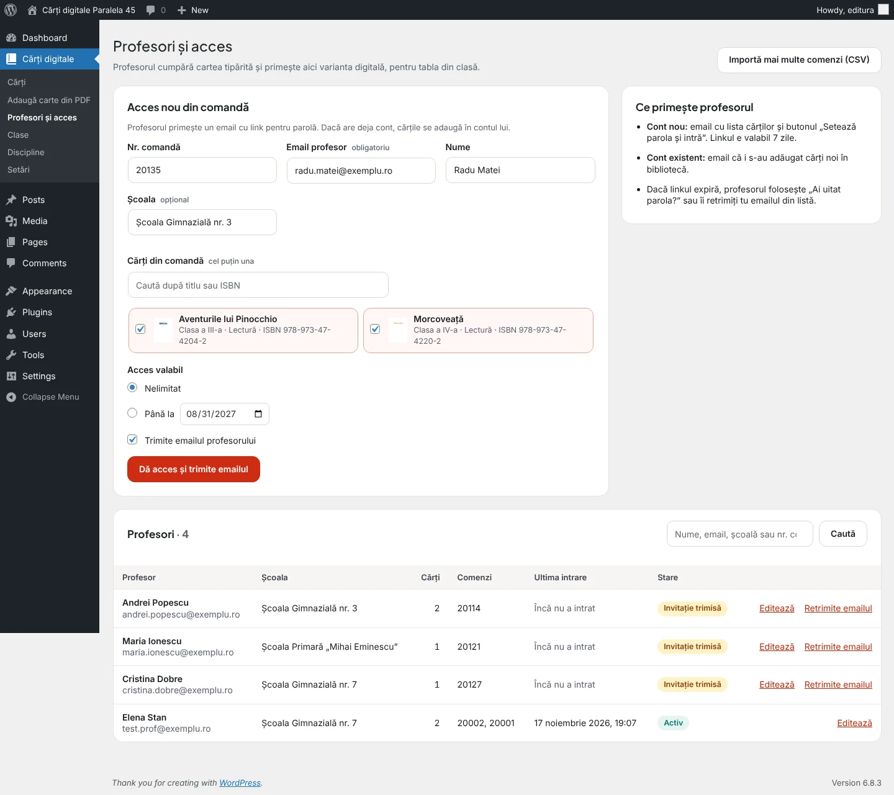 | 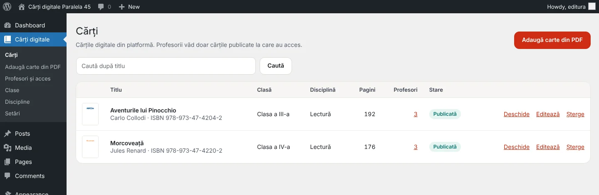 |
| Editura scrie numărul comenzii și emailul, apoi bifează cărțile. Profesorul primește emailul. | Clasă, disciplină, numărul de pagini, profesorii cu acces și starea cărții. |

**Emailul primit de profesor**

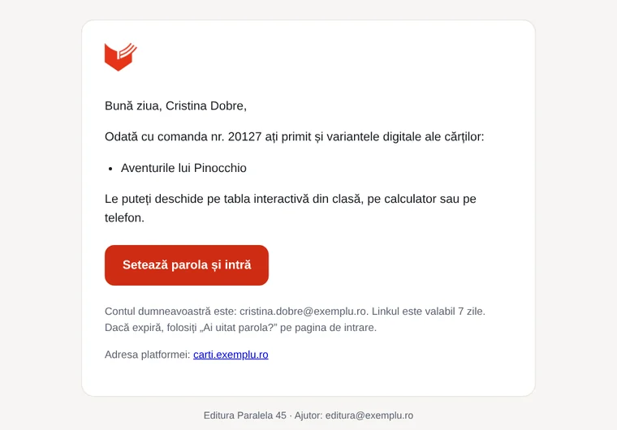

---

## Ce poate face

### Profesorul

- **Biblioteca** arată doar cărțile la care are acces, cu „Continuă de unde ai rămas”, căutare și filtre pe clasă.
- **Cititorul** arată două pagini pe calculator și una pe telefon. Are animație de răsfoire, cuprins pe capitole, miniaturi, salt la o pagină, zoom și ecran complet.
- **Desen peste pagini:** creion, marker, radieră, cinci culori, anulare și „Șterge tot”. Desenul rămâne lipit de pagină la orice mărime a ecranului.
- **Semne de carte și note private**, legate de pagină.
- **Mod Tablă**, pentru tabla interactivă: pagini mari, butoane mari, cuprins și zoom din bara de jos. Notele sunt ascunse implicit, ca să nu apară în fața clasei.
- **Totul se salvează în cont:** ultima pagină, desenele, notele și semnele de carte. Ce a pregătit acasă, profesorul găsește la clasă, pe alt calculator.

### Editura

- **Carte nouă din PDF**, direct din panoul WordPress. Merge și cu PDF-uri de tipar de câteva sute de MB, pentru că PDF-ul nu se urcă pe server.
- **Completare automată** a titlului, ISBN-ului și anului. Cuprinsul se ia din semnele de carte ale PDF-ului, din titlurile capitolelor („Capitolul…”, „Unitatea…”, „Lecția…”) sau din pagina „Cuprins”.
- **Organizare** pe clase și discipline, cu stare publicată sau ciornă, copertă opțională și înlocuirea PDF-ului cu o versiune nouă.
- **Acces din comandă:** număr de comandă, email, nume, școală și cărțile cumpărate. Accesul poate fi nelimitat sau până la o dată.
- **Emailuri automate.** Un cont nou primește un link pentru parolă. Un cont existent primește lista cărților adăugate.
- **Import CSV** pentru multe comenzi odată (modelul e inclus).
- **Lista profesorilor** arată școala, comenzile, ultima intrare și starea (invitație trimisă sau activ). Emailul se poate retrimite.

### Protecția conținutului

- Paginile sunt imagini servite **doar prin platformă și doar profesorilor cu acces**. Dosarul cu pagini are un nume aleator și e blocat la accesul direct.
- PDF-ul original nu ajunge pe server și nu se poate descărca.
- **Emailul profesorului apare pe fiecare pagină.**
- Încercările de intrare și cererile de resetare a parolei sunt limitate.
- Profesorii nu au acces la panoul WordPress.

> Protecția descurajează copierea, dar nu o poate face imposibilă: o captură de ecran rămâne posibilă. De aceea fiecare pagină poartă emailul profesorului.

### Rezultate pe cărți reale

| Carte | Pagini | PDF de tipar | Conversie | Pe server | Cuprins găsit |
|---|---:|---:|---:|---:|---|
| *Aventurile lui Pinocchio* | 192 | 383 MB | ~1 minut | 29 MB | 36 capitole, cu subtitluri |
| *Morcoveață* | 176 | 147 MB | ~50 de secunde | 28 MB | 49 de capitole, din pagina „Cuprins” |

Conversiile au fost făcute pe un calculator obișnuit, în Chrome.

---

## Cum funcționează

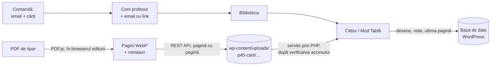

1. **Conversia** se face în browser, cu [PDF.js](https://mozilla.github.io/pdf.js/). Fiecare pagină se desenează la 1400 px lățime și se salvează ca WebP (sau JPEG, dacă browserul nu știe WebP), plus o miniatură. Paginile se urcă una câte una, așa că limitele obișnuite de upload ale hostingului sunt suficiente.
2. **Cuprinsul** se caută în trei locuri, în ordine: semnele de carte (outline-ul) din PDF, titlurile de capitol de la începutul paginilor și pagina „Cuprins”. În ultimul caz, titlurile sunt găsite în paginile cărții, ca să meargă și când numerele de pagină tipărite nu se potrivesc cu cele din PDF.
3. **Accesul** se ține într-un tabel separat (profesor, carte, comandă, expirare). Fiecare imagine trece prin PHP, care verifică accesul înainte de a trimite fișierul.
4. **Starea cititorului** (ultima pagină, desene, note, semne de carte) se salvează pe server, cu o copie în browser pentru cazul în care conexiunea cade.

---

## Instalare

**Cerințe:** WordPress 6.2+ și PHP 7.4+. Pentru conversie e nevoie de Chrome, Edge sau Firefox actualizat.

> **Important:** instalează pluginul pe un **WordPress separat**, de exemplu pe un subdomeniu precum `carti.domeniu.ro`. După activare, tot site-ul devine platforma: orice altă pagină duce la intrare sau la bibliotecă.

1. Descarcă `p45-carti-digitale.zip` din [**Releases**](../../releases). Nu folosi „Code → Download ZIP”, care conține sursele pentru GitHub.
2. În WordPress: **Module → Adaugă nou → Încarcă modul**, alege arhiva, apoi **Instalează acum** și **Activează**.
3. **Cărți digitale → Setări:** completează emailul de suport și trimite-ți un email de test. Dacă nu ajunge, instalează un modul SMTP, de exemplu *WP Mail SMTP*.
4. Adaugă prima carte din **Cărți digitale → Adaugă carte din PDF**.

**Pe nginx**, adaugă în configurarea site-ului regula de mai jos. Pe Apache, dosarul e protejat automat prin `.htaccess`.

```nginx
location ^~ /wp-content/uploads/p45-carti/ { deny all; }
```

**Copia de siguranță** trebuie să cuprindă baza de date și dosarul `wp-content/uploads/p45-carti/`.

Ghidul pas cu pas, în limbaj simplu, este în [`CITESTE-MA.txt`](CITESTE-MA.txt). El intră și în arhiva pluginului.

---

## Structura codului

```
p45-carti-digitale/
├── p45-carti-digitale.php   antetul pluginului, constante, încărcarea modulelor
├── includes/
│   ├── install.php          tabele, rolul „Profesor”, clase și discipline implicite
│   ├── cpt.php              tipul „Carte” și taxonomiile clasă / disciplină
│   ├── access.php           cine ce poate citi; salvarea stării cititorului
│   ├── routes.php           adresele publice, intrarea, parola, servirea imaginilor
│   ├── rest.php             REST API: cărți, conversie, pagini, stare
│   ├── mail.php             emailurile HTML (invitație, cărți noi, parolă)
│   └── functions.php        setări, adrese, cuprins, utilitare
├── admin/                   paginile din panoul WordPress
│   ├── carti.php            lista și editorul de carte (conversia din PDF)
│   ├── profesori.php        acces din comandă, import CSV, lista profesorilor
│   ├── setari.php           email de suport, valabilitatea linkului, calitatea imaginilor
│   └── admin.php            meniul și mesajele
├── templates/               paginile pentru profesori
│   ├── intra.php · parola.php · biblioteca.php · cititor.php · mesaj.php · parts.php
├── assets/
│   ├── js/convertor.js      PDF → pagini, detectarea cuprinsului, încărcarea
│   ├── js/cititor.js        flipbook, desen, note, semne de carte, Mod Tablă
│   ├── css/                 app.css · cititor.css · admin.css
│   ├── img/                 logo și coperte pentru pagina de intrare
│   ├── model-import.csv     modelul pentru importul de comenzi
│   └── vendor/              PDF.js 6.5 (Apache-2.0) și StPageFlip 2.0 (MIT)
├── CITESTE-MA.txt           ghidul de instalare pentru editură
├── docs/capturi/            capturile din acest README (nu intră în arhivă)
└── scripts/                 construirea arhivei pentru WordPress (nu intră în arhivă)
```

Codul propriu are aproximativ 5.400 de linii (PHP, JavaScript și CSS), fără biblioteci externe și fără pas de compilare.

---

## Detalii tehnice

<details>
<summary><b>Date, roluri și adrese</b></summary>

| Ce | Unde |
|---|---|
| Cărțile | tipul de conținut `p45_carte`, cu taxonomiile `p45_clasa` și `p45_disciplina` |
| Accesul | tabelul `wp_p45_acces` (profesor, carte, comandă, expirare), cu cheie unică pe profesor și carte |
| Starea cititorului | tabelul `wp_p45_date` (JSON per profesor și carte: ultima pagină, desene, note, semne) |
| Paginile | `wp-content/uploads/p45-carti/<id>-<token>/` (`p` pagini, `m` miniaturi, `c` copertă) |
| Profesorii | rolul `p45_profesor`, fără acces la `wp-admin` |
| Editura | capabilitatea `p45_gestionare` (administrator și editor) |

Adresele publice sunt `/intra/`, `/parola/`, `/biblioteca/`, `/carte/<id>-<titlu>/`, `/carte/…?tabla=1` (deschide direct în Mod Tablă) și `/iesire/`.

</details>

<details>
<summary><b>REST API (<code>/wp-json/p45/v1</code>)</b></summary>

| Metodă | Rută | Rol |
|---|---|---|
| `POST` | `/carti` | creează o carte (editura) |
| `POST` / `DELETE` | `/carti/{id}` | actualizează sau șterge o carte |
| `POST` | `/carti/{id}/conversie` | începe o conversie și pregătește un dosar nou |
| `POST` | `/carti/{id}/pagina` | primește o pagină și miniatura ei |
| `POST` | `/carti/{id}/coperta` | primește coperta |
| `POST` | `/carti/{id}/finalizare` | activează paginile noi și le șterge pe cele vechi |
| `GET` / `POST` | `/stare/{id}` | starea cititorului pentru profesorul conectat |

Toate rutele cer nonce-ul `wp_rest`. Rutele pentru cărți cer `p45_gestionare`, iar `/stare` cere acces la carte.

</details>

<details>
<summary><b>Securitate</b></summary>

- Imaginile se servesc prin `?p45_img=<id>&p45_t=p|m|c&p45_n=<pagina>`, după verificarea accesului. Răspunsul are `X-Robots-Tag: noindex` și `Cache-Control: private`.
- Dosarul fiecărei cărți are un token aleator în nume, iar o reconversie face un dosar nou și îl șterge pe cel vechi.
- După 8 încercări greșite de intrare, intrarea se blochează 15 minute. Se pot cere cel mult 6 linkuri de parolă pe oră.
- Starea trimisă de cititor este validată (structură, dimensiune, numere de pagină) înainte de salvare.
- Testat: o cerere anonimă către o imagine primește 403, la fel și un profesor fără acces la carte. Un profesor nu poate apela rutele editurii.

</details>

<details>
<summary><b>Setări</b></summary>

Din **Cărți digitale → Setări** se pot schimba emailul de suport (apare la profesori și în emailuri), valabilitatea linkului de parolă (implicit 7 zile), lățimea paginilor (implicit 1400 px) și calitatea imaginilor (implicit 80).

</details>

---

## Dezvoltare

Pluginul nu are dependențe și nici pas de compilare: fișierele din repository sunt chiar cele care rulează în WordPress.

```bash
# arhiva pentru WordPress, în dist/p45-carti-digitale.zip
bash scripts/construieste-zip.sh
```

Scriptul pune în arhivă doar fișierele pluginului (fără `docs/`, `scripts/` sau README). Folosește `zip` sau, dacă nu există, Python 3.

**Versiune nouă:**

1. Crește numărul versiunii în antetul din `p45-carti-digitale.php` (`Version`) și în constanta `P45CD_VERSION`.
2. Publică un *Release* pe GitHub, de exemplu cu eticheta `v1.0.1`.
3. GitHub Actions verifică sintaxa PHP, construiește arhiva și o atașează automat la versiune ([`.github/workflows/arhiva.yml`](.github/workflows/arhiva.yml)).

Pentru teste locale ajunge un WordPress cu SQLite (modulul *SQLite Database Integration*) pe serverul inclus în PHP (`php -S`).

---

## Licență

Codul pluginului este distribuit sub **GPL-2.0-or-later** (vezi [LICENSE](LICENSE)), ca WordPress.

Biblioteci incluse:

- [PDF.js](https://github.com/mozilla/pdf.js) de la Mozilla, Apache-2.0;
- [StPageFlip](https://github.com/Nodlik/StPageFlip), MIT.

Licențele lor sunt în `assets/vendor/`. Fonturile [Inter](https://rsms.me/inter/) și [Plus Jakarta Sans](https://github.com/tokotype/PlusJakartaSans) (SIL OFL) se încarcă de la Google Fonts.

Logo-ul, copertele din `assets/img/` și paginile de carte din capturi aparțin **Editurii Paralela 45** și nu intră sub licența GPL.

---

<sub>**In English:** a WordPress plugin that turns a publisher's print-ready PDFs into page-flip books for teachers. Conversion runs in the browser with PDF.js, so the PDF never reaches the server. Access is granted per order. The reader has a whiteboard mode, drawing over pages, private notes, bookmarks and a per-teacher email watermark.</sub>
